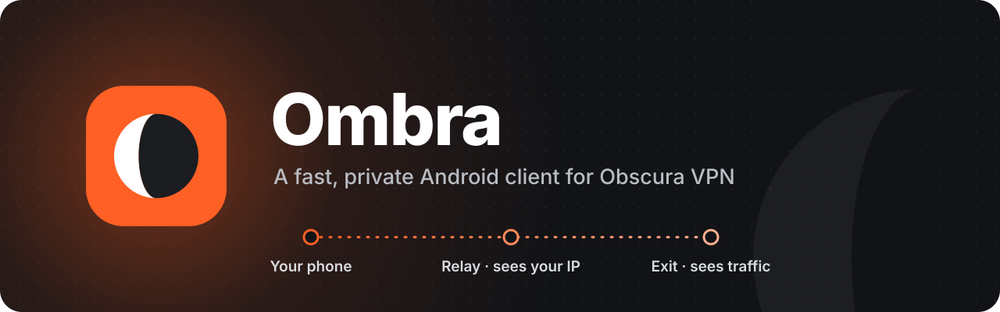

<p align="center">
  
</p>

# Ombra

An independent Android client for [Obscura VPN](https://obscura.net), built for speed and privacy: a
native Jetpack Compose app on top of the upstream Obscura Rust core, with our own patches. Ombra is not
made by Obscura.

Android 16 or newer (API 36), arm64.

## Changes from the official app

**Speed**

- **A data path for phones.** TUN writes run in their own thread, the Rust core uses one worker thread,
  and its threads get normal Linux scheduling. This is the largest gain: downloads about 9x faster.
- **Speed mode.** Plain WireGuard over UDP through the same two-hop relay, for networks that do not
  block WireGuard. Networks can see it and can tell which exit server you use. The relay cannot
  check that packets come from you.
- **QUIC tuned for a tunnel.** A 1350-byte packet floor (no packet is split in two), fewer ACKs,
  a shorter datagram queue, larger UDP buffers.
- **Cheaper padding.** Small packets share one padded packet (about 10x less upload than one padded
  packet each), and a packet after a quiet moment does not wait.
- **Better connects.** The relay race avoids UDP port 53 unless it is clearly faster, failed connects
  back off, and a switch between Wi-Fi and mobile data keeps the tunnel.

**Control**

- Choose the entry relay and the exit: country, city, server or "Fastest". Pin favourites.
- Three protocols: Stealth (WireGuard in QUIC), Speed (WireGuard over UDP), TCP/TLS.
- DNS content blocking, custom DNS servers, split tunnelling, local network access, MTU options.
- Kill switch status, Quick Settings tile, shortcuts.

**Privacy**

- No analytics, no crash reporting, no Google Play Services, no third-party SDKs. The app code makes
  no network calls; the Rust core makes all of them (see [Network](#network)).
- The WireGuard secret key is encrypted with an Android Keystore key (StrongBox when available) and
  never written to the config file. The config file, with the account number and the login token, is
  encrypted too.
- A new WireGuard key every 30 days, every day or at each connect. The exit server can link your
  sessions only while it sees the same key.
- No log files and almost nothing in logcat unless you turn on Diagnostics.
- Screenshots blocked on the account screens; a copied account number is cleared after 60 s.
- Referral: when you create an account, a switch (on by default) adds the Obscura referral code of
  the Ombra developer. After your first payment, you and the developer each get one free month.
  Obscura links the two accounts until one month after the free months. Turn the switch off, and
  Ombra sends no referral. Login with an existing account never sends one.
- Ombra talks to the Obscura API outside the tunnel, also in Stealth mode. The network can see the
  name of the API (in the DNS lookup and in TLS), and the API sees your IP address.
- The Obscura API sees that you use Ombra and which version: the User-Agent is
  `Ombra-Android/<version>`, as the Obscura API documentation asks of other clients.

The full list of patches to the Rust core is in [rust/UPSTREAM.md](rust/UPSTREAM.md).

## Network

Ombra connects only to these hosts:

- The Obscura API, `v1.api.prod.obscura.net` (built-in first address `66.42.95.12`). When it cannot
  be reached: the backup domain `crimsonlance.net`, then the backup API host that you set in Advanced.
  Ombra calls the API when it starts, after a login, every 12 h, at each connect and for account
  actions.
- The entry relays from the Obscura relay list: the relay race and the tunnel. The exit gets your
  traffic only through the relay.
- Only for a debug bundle, after you agree on its page: DNS lookups and HTTPS requests to
  `www.apple.com` and `google.com`, HTTPS requests to the Obscura API (also with `apple.com` and
  `google.com` as the TLS name), and pings to `1.1.1.1`, `8.8.8.8`, `2606:4700:4700::1111` and
  `2001:4860:4860::8888`.

Links, for example the payment page, open in your browser.

## Results

Pixel 9 Pro XL, Android 17, one 5 GHz Wi-Fi network. Official Obscura app v1.181 against Ombra 0.2.1,
both through the same entry relay. The numbers are **estimates**: one or two 8 s runs per cell, on a
network that varied by up to 30 % between runs.

| | Official app | Ombra, Stealth with padding | Ombra, Speed |
|---|---|---|---|
| Download, 4 streams | ~30 Mbit/s | **~270 Mbit/s** (~9x) | **~270 Mbit/s** (~9x) |
| Download, 1 stream | ~40 Mbit/s | **~270 Mbit/s** (~7x) | **~270 Mbit/s** (~7x) |
| Upload, 4 streams | ~85 Mbit/s | **~240 Mbit/s** (~3x) | **~260 Mbit/s** (~3x) |
| Ping during an upload | ~110 to 250 ms | **~25 to 55 ms** | **~50 ms** |
| Idle ping | ~18 ms | ~18 ms | ~18 ms |
| CPU time per GB downloaded | ~300 s | **~25 s** | **~23 s** |

The official app ran with its default settings (padding off); with padding on it gave the same
speeds. Its CPU time comes from a test on another day. Raw numbers and method:
[docs/research/device-test.md](docs/research/device-test.md).

## Build

Requirements: JDK 21, Android SDK 37, NDK 28.0.13004108, Rust 1.89.0 with the
`aarch64-linux-android` target, cargo-ndk 4.

```sh
JAVA_HOME=/opt/homebrew/opt/openjdk@21 ./gradlew :app:assembleDebug :app:testDebugUnitTest
```

Gradle builds the Rust core with `scripts/build-rust.zsh` (offline, 16 KB pages, stripped). Release
builds are signed with the key that `scripts/make-release-key.sh` makes; without it,
`assembleRelease` makes an unsigned APK. The release APK is about 13.1 MB (estimate); the Rust core is
about 9.7 MB of it.

Before each release tag, run `scripts/audit-rust.zsh`. It checks the Rust crates of the Android build
against the RustSec advisory database (needs `cargo-deny`).

## Licence

GPL-3.0-only ([LICENSE](LICENSE)). The Rust core comes from
[obscuravpn-client](https://github.com/Sovereign-Engineering/obscuravpn-client) by Sovereign
Engineering (GPL-3.0-only with a linking exception). Fonts: Manrope and JetBrains Mono (OFL-1.1).
The list of the Rust crates and their licence texts are in
[app/src/main/assets/licenses](app/src/main/assets/licenses) and on the Licences screen of the app.
"Obscura" is a trademark of its owner; Ombra uses its own name and icon.
